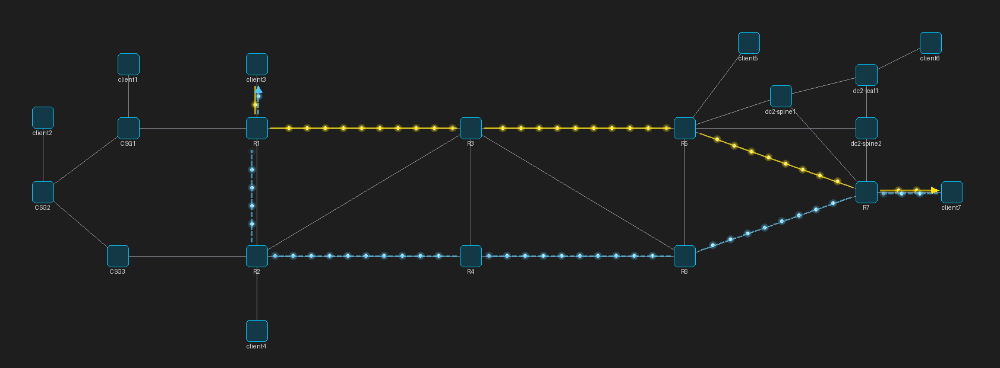

# clab-color-trace

**See where your traffic actually goes, live on the containerlab topology.**

Created by **Abubaker Fageary** ([@afageary](https://github.com/afageary)).

`clab-color-trace` follows real traffic from a Linux client through a containerlab lab and highlights the links it crosses, in color, directly on the [TopoViewer](https://containerlab.dev/manual/vsc-extension/) canvas in VS Code. The colors appear as soon as the traffic starts and disappear when it stops. This makes it easy to check SRv6 or SR-MPLS policies, ECMP choices, failover and asymmetric routing at a glance.



## Main idea

1. **Capture everywhere.** `tcpdump` runs on every lab interface, inside each node's network namespace, in both directions. It runs from the host side, so the router images need no extra tools.
2. **Recognize the flow, whatever the encapsulation.** The client's packets are found by their *inner* IPv4/IPv6 header: addresses, protocol, and ICMP type or TCP/UDP port. That works through SRv6, SR-MPLS, VXLAN and VLAN encapsulation.
3. **Rebuild the path.** A hop A→Z counts when the packet is seen leaving A or arriving at Z. The hops are chained into a forward path and a return path.
4. **Draw it on TopoViewer.** The result is written into the lab's `<topology>.annotations.json` as line shapes, a legend and an animated image. TopoViewer reloads the file automatically.

## Features

- **Live mode:** the path lights up about a second after the traffic starts and clears a few seconds after it stops.
- **Any traffic:** ping (ICMP), iperf3 and other TCP or UDP traffic, over IPv4 and IPv6.
- **Forward and return paths:** the forward path is solid in the flow color and the return path is dashed in light blue, so asymmetric routing stands out.
- **Animated:** glowing pulses travel along each link in the direction of traffic. An arrowhead marks the last hop of each direction.
- **Non-intrusive:** the overlay sits under links and nodes, so the right-click menus (Wireshark capture, impairments, traffic graphs, SSH) keep working. Your own annotations are never touched.
- **Multi-vendor:** tested with Nokia SR-SIM (including multi-card chassis), SR Linux and Linux nodes.
- **Built for heavy traffic:** sampling keeps the CPU use low even during full-rate iperf tests.
- **One-off traces:** besides live mode, it can run a single trace that saves HTML, JSON, Mermaid and pcap reports.

## Requirements

- containerlab with a deployed lab, and the Containerlab VS Code extension (TopoViewer).
- On a Linux host: root, `docker`, `tcpdump`, `nsenter` (util-linux), `iproute2`, Python 3.8+, and optionally Pillow for the animation.
- On macOS (Docker Desktop or OrbStack): only Docker. The included wrapper runs everything in a helper container.
- Client containers need the iputils `ping`, for example `nicolaka/netshoot` or `network-multitool` with `apk add iputils`.
- Open the lab folder in VS Code, so TopoViewer picks up changes to the annotations file.

## Usage

Run the commands from the folder that contains your topology file.

```bash
# Linux host
sudo ./clab_color_trace.py -t mylab.clab.yml --watch client1 10.0.2.2 yellow

# macOS
./clab-color-trace-docker.sh -t mylab.clab.yml --watch client1 10.0.2.2 yellow
```

Then generate traffic as usual, for example:

```bash
docker exec -it clab-mylab-client1 ping 10.0.2.2
docker exec -it clab-mylab-client1 iperf3 -c 10.0.2.2 -u -b 10M -t 30
```

Press Ctrl-C to stop the watcher; this also removes the colors.

### Common examples

```bash
--watch client1 10.0.2.2 yellow                 # ping (default)
--watch client1 10.0.2.2 yellow --port 5201     # iperf3, TCP and UDP
--watch client1 any yellow --proto any          # everything client1 sends
--watch c1 10.0.2.2 red --watch c3 10.0.4.4 green   # several flows at once
--flow  client1 10.0.2.2 red                    # one-off trace with saved report
--clear                                         # remove all highlights
```

### Main options

| Option | Purpose | Default |
|---|---|---|
| `--watch SRC DST COLOR` | Follow live traffic from node SRC to DST (an IP or `any`) | – |
| `--proto` | `icmp`, `tcp`, `udp`, a comma list, or `any` | `icmp`, or `tcp,udp` with `--port` |
| `--port N` | Only TCP/UDP with this source or destination port | all ports |
| `--idle S` | Seconds without packets before the color clears | 3 |
| `--reply-color` | Color of the return path (`same` uses the flow color) | lightblue |
| `--no-animate` | Static colors only | animated |
| `--arrow-size`, `--line-width` | Look of the overlay | 14, 4 |
| `--iface-map N:IF=LINUXIF` | Manual interface-name mapping | auto |

Run `--help` for the full list.

## Notes

- Packets that are dropped along the way show up as a path that ends early. One example is oversized UDP that no longer fits the MTU after SRv6 encapsulation.
- Each flow follows a single ECMP member. Use more sources, destinations or parallel streams to see the others.
- The annotation formats follow the Containerlab VS Code extension v0.27. A future TopoViewer version could change them.

## Author

Abubaker Fageary ([@afageary](https://github.com/afageary)). Issues and pull requests are welcome.

## License

MIT. See [LICENSE](LICENSE).
